# Отчёт по лабораторной работе № 5

## Оглавление

0. [Выбор CNI](#cni)
1. [Развёртывание приложения и исследование сети Pod](#pod-networking)
2. [Непрерывность работы сервиса при удалении Pod](#pod-chaos)
3. [Матрица сетевого доступа](#access-matrix)
4. [Настройка Zero Trust](#zero-trust)
5. [Проверка матрицы сетевого доступа](#matrix-verification)
6. [Диагностика нарушения сетевой связности](#connectivity-diagnostics)
7. [Мониторинг и алерты](#monitoring)
8. [Выводы](#conclusions)

<a id="cni"></a>
## 0. Выбор CNI

В качестве CNI был выбран Cilium, в первую очередь потому что даёт подробную наблюдаемость сети в кластере через Hubble.
Эта особенность явно будет полезна для дебага сетевых политик в этой работе.

Для использования Cilium с k3d пришлось пересоздать кластер, но без встроенного flannel.
После этого ставится сам Cilium Helm-чартом.

<a id="pod-networking"></a>
## 1. Развёртывание приложения и исследование сети Pod

Посмотрим, что вообще происходит с точки зрения сети внутри приложения.
Для начала посмотрим IP подов.

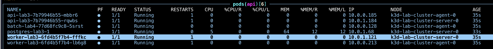

Для адресации используется внутренний диапазон, причём уникальный для каждой ноды.
У агент-ноды это `10.0.0.0.x`, у сервер-ноды — `10.0.0.1.x`.

Посмотрим, какие интерфейсы есть внутри пода. В под api/worker через exec не зайти (потому что образ совсем минимальный),
поэтому используем `kubectl debug`, дабы в существующем поде api создать эфемерный временный контейнер,
который содержит тулзы для сетевой диагностики.

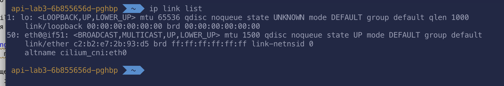

В самом поде есть интерфейс eth0, который смотрит на veth на ноде.
Veth — это виртуальный интерфейс. Найдём на ноде соответствующий veth-интерфейс.
Его можно определить по ID интерфейсов: интерфейсу eth0 с ID n соответствует veth с ID n+1.
Чтобы это проверить, зайдём на ноду (жёсткий docker exec в контейнер ноды).

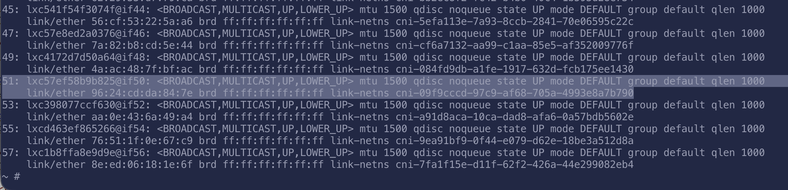

На ноде действительно были обнаружены соответствующие виртуальные интерфейсы.

Проверим сетевую доступность подов с разных нод. Снова создадим дебаг-контейнер и пропингуем поды, расположенные на разных нодах.
Расположение на разных нодах можно проверить по их IP-адресу.

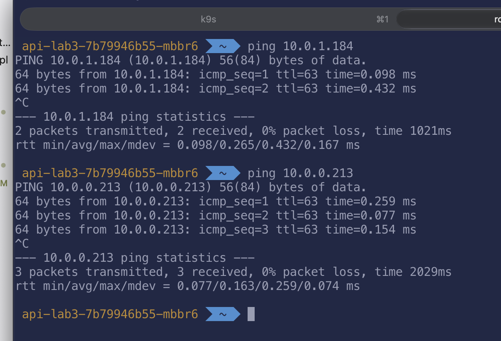

Сетевая доступность присутствует.

<a id="pod-chaos"></a>
## 2. Непрерывность работы сервиса при удалении Pod

Временно настроим api для работы через NodePort.
Предоставление доступа через NodePort предполагает, что на каждой ноде кластера будет открыт порт (обычно из диапазона  30000-32767), через который трафик будет проксироваться на приложение.

Заставим GPT написать скрипт для хаос-тестирования, который будет случайно удалять поды, и будем регулярно в цикле пинговать приложение по DNS-имени.

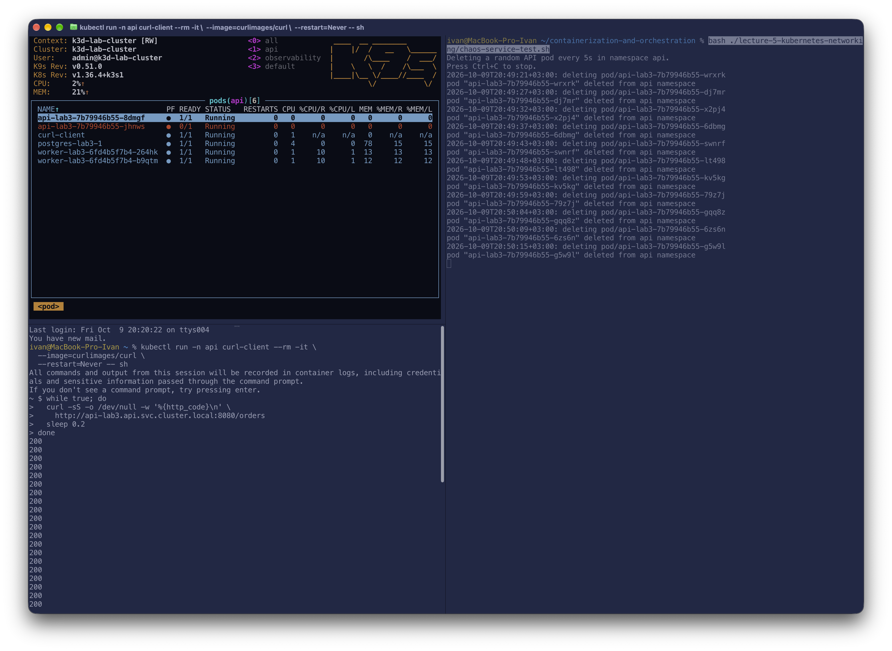
Можно увидеть, что все запросы были успешно обработаны.

Почему это работает:
- У сервиса есть стабильный виртуальный адрес (ClusterIP), по которому идёт обращение к сервису
- DNS куба преобразует запись в адрес сервиса
- Сам сервис определяет селектор подов и куда направлять трафик в подах. Актуальная информация об IP подов хранится в EndpointSlice
- Если используется iptables, то kube-proxy настраивает их для маршрутизации
- В случае Cilium вместо iptables используется eBPF с какими-то eBPF maps для настройки роутинга.

<a id="access-matrix"></a>
## 3. Матрица сетевого доступа

Кратко по матрице:
- надо не сломать мониторинг
- оставить доступ с Ingress, чтобы трафик из внешки через них ходил
- оставить доступ к DNS
- оставить доступ оператору PostgreSQL

В процессе тестирования ещё выяснилась необходимость выдать доступ для PostgreSQL на подключение к порту 6443 для доступа к Kubernetes API.
Это нужно для чтения конфигурации кластера.
Подробнее как это диагностировалось будет в части про диагностику нарушения сетевой связности (кейс для диагностики сам меня настиг...)

| Откуда                                       | Куда                                      | Порт           | Протокол | Доступ |
|----------------------------------------------|-------------------------------------------|---------------:|:--------:|:------:|
| Внешний трафик                               | Traefik                                   |    `80`, `443` |   TCP    |   ✅   |
| Traefik                                      | api                                       |         `8080` |   TCP    |   ✅   |
| Traefik                                      | worker                                    |         `8080` |   TCP    |   ✅   |
| Тестовые поды в кластере (для заданий нужно) | api                                       |         `8080` |   TCP    |   ❌   |
| api                                          | PostgreSQL                                |         `5432` |   TCP    |   ✅   |
| worker                                       | PostgreSQL                                |         `5432` |   TCP    |   ✅   |
| CloudNativePG operator                       | PostgreSQL под                            |         `8000` |   TCP    |   ✅   |
| PostgreSQL под                               | под из того же кластера (при репликации)  | `5432`, `8000` |   TCP    |   ✅   |
| PostgreSQL под                               | Любой адрес (надо для initDB)             |         `6443` |   TCP    |   ✅   |
| api                                          | Jaeger                                    |         `4318` |   TCP    |   ✅   |
| Prometheus                                   | api, worker, batch                        |         `8080` |   TCP    |   ✅   |
| api, worker, PostgreSQL                      | CoreDNS                                   |           `53` | UDP, TCP |   ✅   |
| Посторонний под                              | PostgreSQL                                |         `5432` |   TCP    |   ❌   |
| Посторонний под                              | api, worker                               |          любые |  любые   |   ❌   |
| api, worker                                  | внешка и другие поды                      |          любые |  любые   |   ❌   |


<a id="zero-trust"></a>
## 4. Настройка Zero Trust
Для реализации Zero Trust была переиспользована [kyverno политика](../helmfile/charts/kyverno-policies/templates/generatingPolicy.yaml) из прошлых работ.
Были поменяны только сами правила внутри автоматически создаваемой политики для соответствия Zero Trust.

<a id="matrix-verification"></a>
## 5. Проверка матрицы сетевого доступа
**Внешний трафик в ингрес: разрешено**

Команда

```bash
kubectl exec -n kube-system traefik-nettest -- \
  sh -c 'nc -vz -w 3 api-lab3.api.svc.cluster.local 8080 2>&1; echo exit=$?'
```

Вывод

```text
Connection to api-lab3.api.svc.cluster.local (10.43.110.218) 8080 port [tcp/http-alt] succeeded!
exit=0
```

**Traefik доступ к api/worker:8080: разрешено**
Команда

```bash
kubectl exec -n kube-system traefik-nettest -- \
  sh -c 'nc -vz -w 3 api-lab3.api.svc.cluster.local 8080 2>&1; echo exit=$?'
```

Вывод

```text
Connection to api-lab3.api.svc.cluster.local (10.43.110.218) 8080 port [tcp/http-alt] succeeded!
exit=0
```

**Посторонний под к api:8080: запрещено**
Команда

```bash
kubectl exec -n api stray-nettest -- \
  sh -c 'nc -vz -w 3 10.43.110.218 8080 2>&1; echo exit=$?'
```

Вывод

```text
nc: connect to 10.43.110.218 port 8080 (tcp) timed out: Operation in progress
exit=1
```

**api/worker доступ к БД: разрешено**

Поды работают и, по логам, успешно подключаются к БД
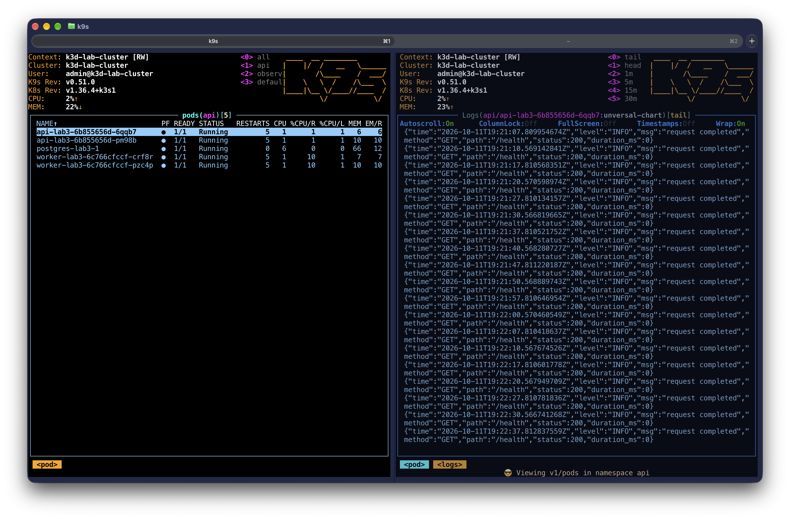

**CloudNativePG operator к БД: разрешено и PostgreSQL → Kubernetes API:6443: разрешено**

Под PostgreSQL поднялся и работает. Без этих разрешений под не создался бы и не прошёл бы инициализацию.

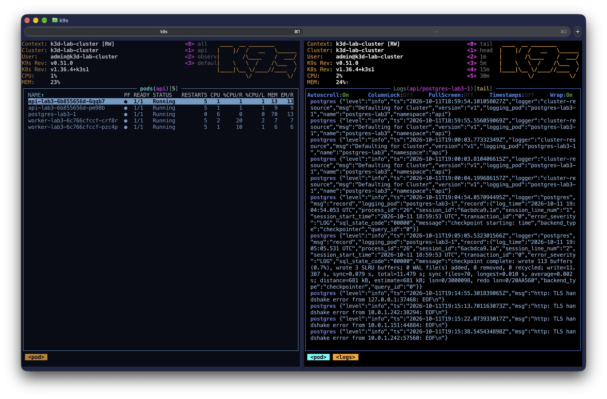

Без разрешения доступа к Kubernetes API зависал бы контейнер initDB

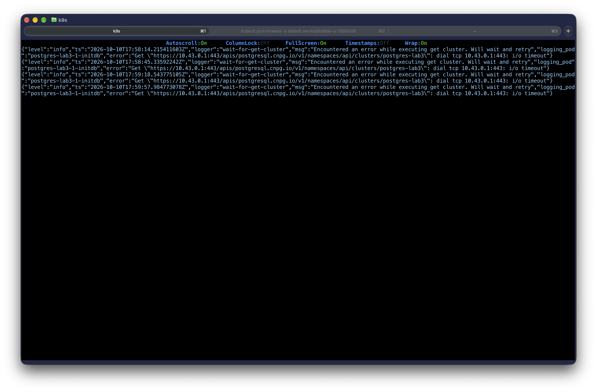

**Доступ к DNS**

Аналогично верхним политикам. Ничего не сломалось, значит работает...

**Работа мониторинга**

Логи, метрики — всё доступно.
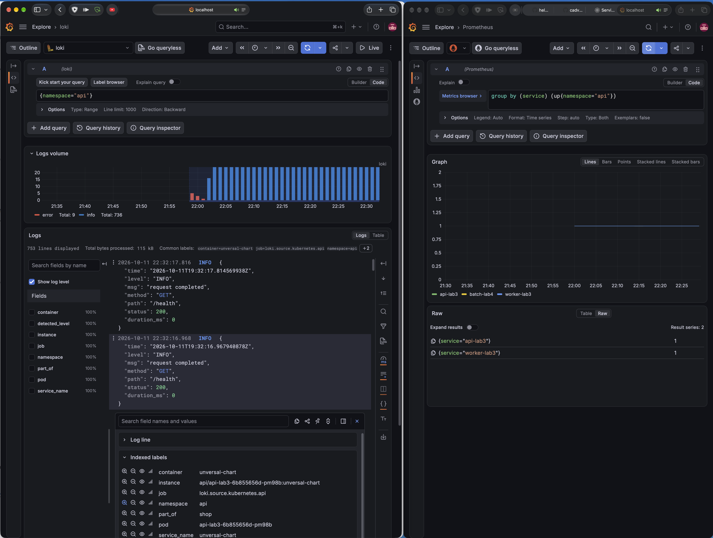

**Посторонний под к БД: запрещено**
Команда

```bash
kubectl exec -n api stray-nettest -- \
  sh -c 'nc -vz -w 3 10.0.1.242 5432 2>&1; echo exit=$?'
```

Вывод

```text
nc: connect to 10.0.1.242 port 5432 (tcp) timed out: Operation in progress
exit=1
```

**Посторонний под к api/worker: запрещено**

Команда

```bash
kubectl exec -n api stray-nettest -- sh -c \
  'nc -vz -w 3 10.43.110.218 8080 2>&1; echo api_exit=$?;
   nc -vz -w 3 10.0.0.39 8080 2>&1; echo worker_exit=$?'
```

Вывод

```text
nc: connect to 10.43.110.218 port 8080 (tcp) timed out: Operation in progress
api_exit=1
nc: connect to 10.0.0.39 port 8080 (tcp) timed out: Operation in progress
worker_exit=1
```


<a id="connectivity-diagnostics"></a>
## 6. Диагностика нарушения сетевой связности
Как уже говорилось, кейс для диагностики был обнаружен натурально при применении политик.

**Диагностика**

Сервисы не работали, потому что не могли подключиться к БД. В логах БД — ошибки контейнера initdb.


В логах initdb видно, что initDB пытается получить информацию о кластере БД,
но получает сетевую ошибку. Для диагностики зайдём в Hubble UI и посмотрим, что происходит в namespace api.
Оставим для диагностики только пакеты со статусом Dropped

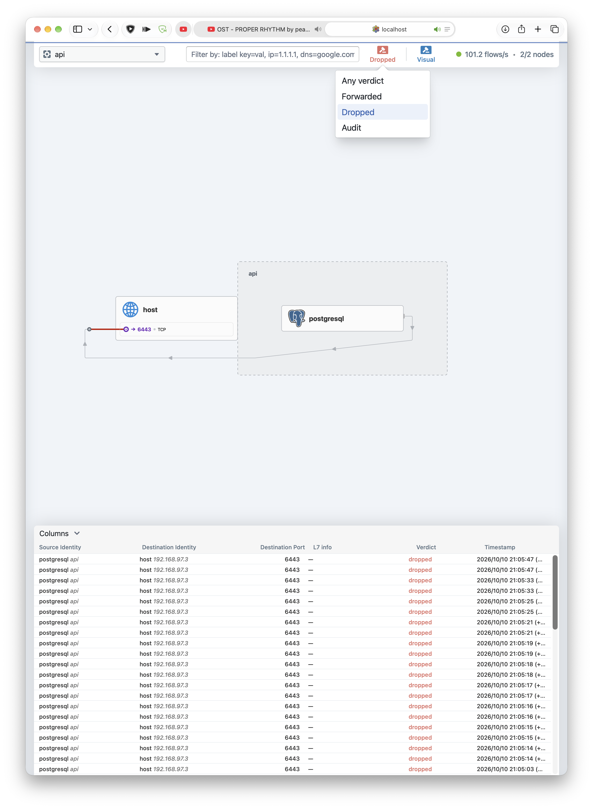

На диаграмме видно, что БД пытается получить доступ к `host:6443` (это API-сервер Kubernetes).
Это можно подтвердить, посмотрев детали одного из дропнутых пакетов,
где видно лейблы пакета, куда и кем он отправлялся.

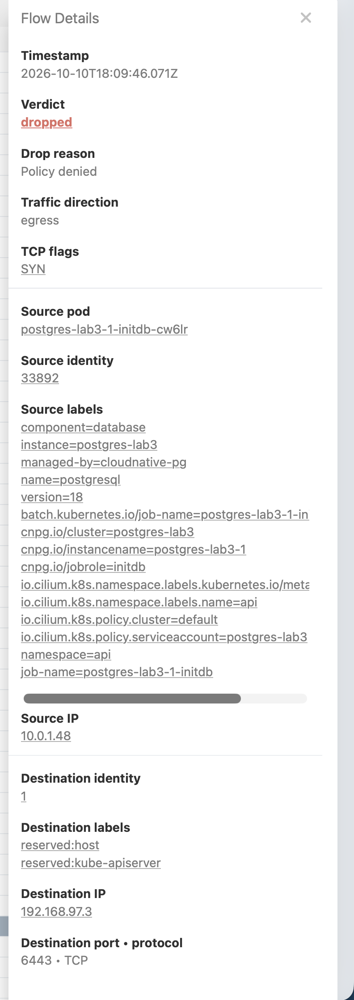

Проблема была исправлена добавлением в политику соответствующего разрешения.

```
    egress:
      - ports:
          - protocol: TCP
            port: 6443
```

<a id="monitoring"></a>
## 7. Мониторинг и алерты

Для мониторинга сети был включён параметр чарта Cilium,
отвечающий за встроенный ServiceMonitor.
Кроме этого, был навешен нужный лейбл для этого ресурса (чтобы kube-prom-stack его видел) и включены метрики Hubble.

Были добавлены следующие графики на дашборд
- ДНС ответы
- дропнутые пакеты с фильтрацией по причине и протоколу
- подключения

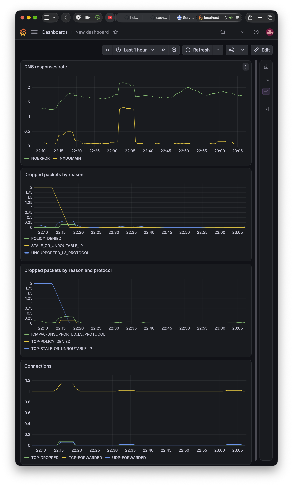

Дашборд был добавлен в ConfigMap, дабы он создавался при деплое Grafana.

<a id="conclusions"></a>
## 8. Выводы

Критически не знаю что тут написать ...
Лабораторная работа сделана, сетевые политики навешены.

Вместо нормальных выводов будет картинка на подумать.


