# Отчёт по лабораторной работе № 6

## Оглавление

0. [Подготовка API и gate-скрипта](#preparation)
1. [Выбор service mesh](#mesh-choice)
2. [Замеры без mesh](#baseline)
3. [Подключение к mesh и проверка mTLS](#mtls)
4. [Проверка отказоустойчивости](#reliability)
5. [Развёртывание v1/v2 и разделение трафика](#traffic-split)
6. [Логика автоматического управления релизом](#autopilot)
7. [Проверка плохого и хорошего релиза](#release-scenarios)
8. [Оценка задержки и расхода ресурсов mesh](#mesh-cost)
9. [Мониторинг](#monitoring)
10. [Выводы](#conclusions)

<a id="preparation"></a>
## 0. Подготовка API и gate-скрипта

Очередной навайбкоженный API, который хз как работает (главное, что работает). 
Gate-скрипт будет сгенерирован позже, 
для него надо хотя бы понять, как разделение трафика будет работать. 

<a id="mesh-choice"></a>
## 1. Выбор service mesh

Я выбрал istio, потому что у нас на работе его планируется внедрять для объединения кластеров.
Ну и в принципе istio больше возможностей предлагает и чаще используется. 
Это также подтверждается статистикой CNCF за 2025 год. 

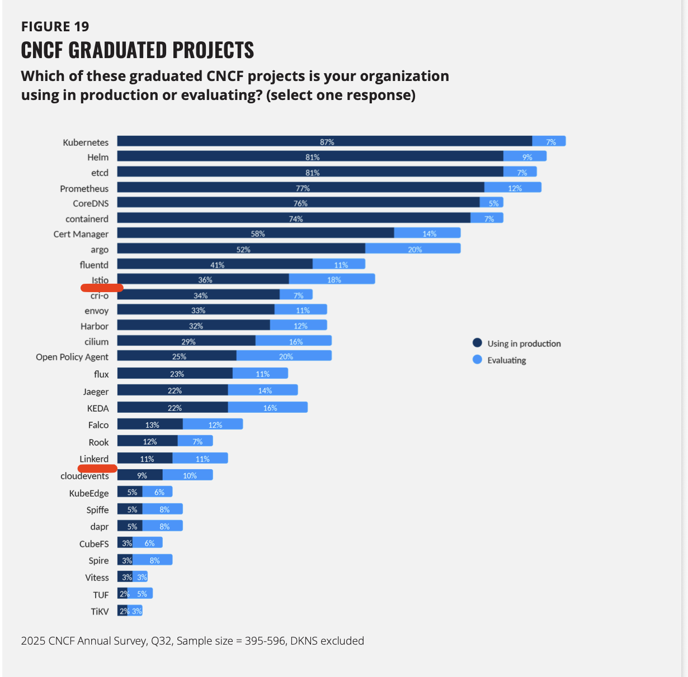

<a id="baseline"></a>
## 2. Замеры без mesh

Простым curl-скриптом подергал 5 минут запросы на api и посмотрел в Grafana задержки.

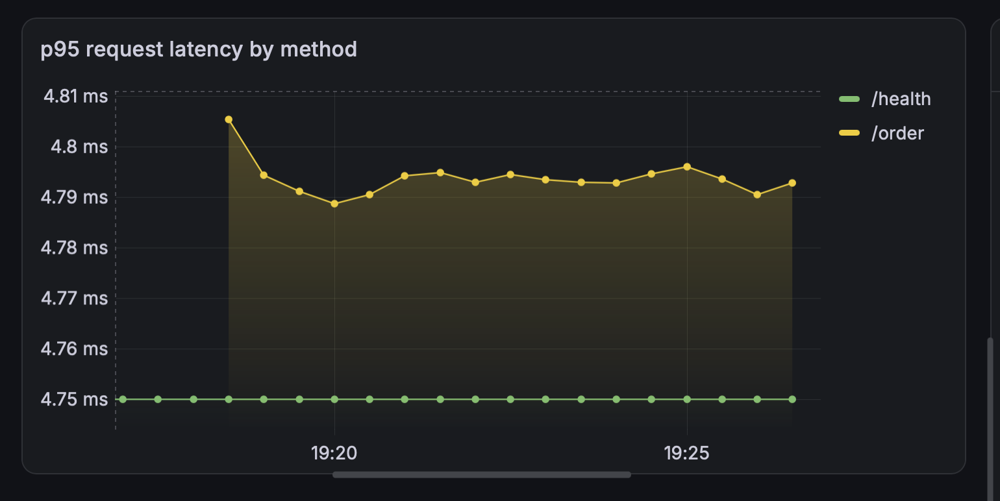

Правда, эти значения оказались бесполезными, потому что это внутренняя метрика в api, 
которая не учитывает полный путь запроса. 
То есть она не изменится после ввода в mesh. 
Потому в сравнении задержки будут получены новые данные реальной задержки через curl, 
для чего пришлось выносить из mesh api и поды траефика. 

Ну и чтобы добру не пропадать, вот этот же график, но только с mesh. 
Значения, как и ожидалось, такие же...

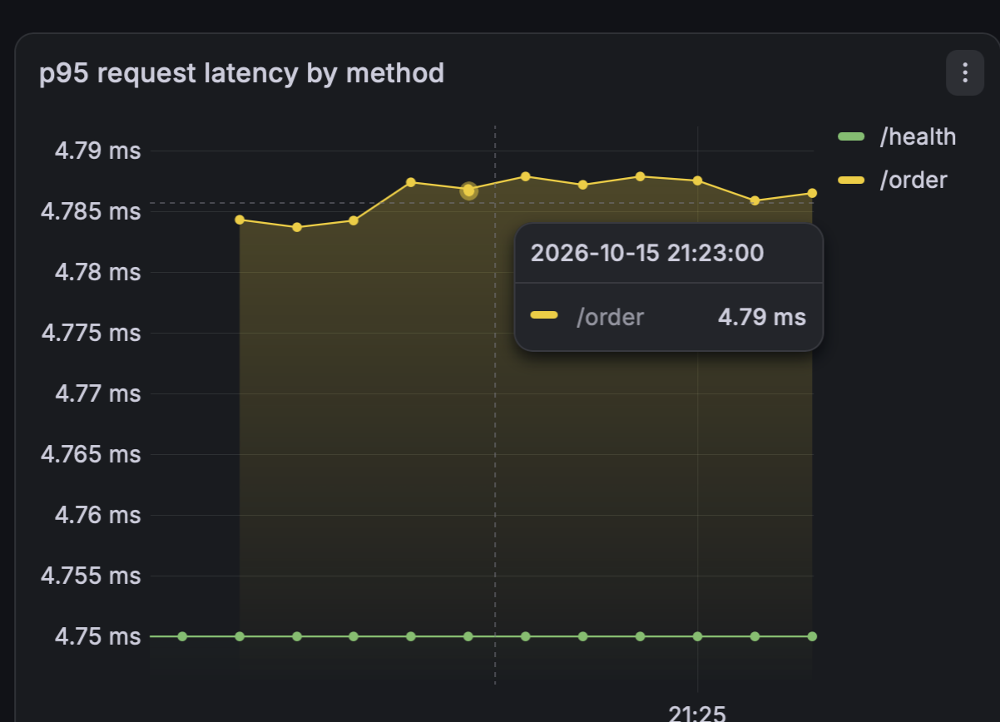

<a id="mtls"></a>
## 3. Подключение к mesh и проверка mTLS

У истио есть два режима работы
- sidecar: по сути просто прокся рядом с подом
- ambient: даемонсетом на каждой ноде развернут ztunnel (на расте написан!!!),
который выступает в качестве L4 прокси. Для более продвинутых фич разворачивается waypoint, 
который уже L7 прокся

В моем случае будем использовать ambient mode. 

Одной из важнейших фич istio является mTLS, позволяющий шифровать трафик и подтверждать личность с обеих сторон запроса. 
В качестве identity приложения выступает его service account.
Однако сейчас все приложения используют дефолтный SA, поэтому в одном namespace они будут иметь один идентификатор. 
Поэтому пропишем в вельюсы api, worker, pg использование своего SA. 
Никаких настроек, никаких RoleBinding, чисто SA, чтобы разный identity в mTLS был.

Деплоить буду хельм-чартиками. В самом процессе ничего интересного, поэтому пройдусь по тому, что сломалось во время установки:
- Cilium из-за настройки `cni.exclusive=false` перезаписывал конфигурацию istio, потому пришлось убирать этот флаг
- Сломались кубовые пробы в api ns из-за default-deny policy, применил [костыль](../helmfile/charts/istio-templates/templates/waypointPolicy.yaml) из [доки](https://istio.io/latest/docs/ambient/install/platform-prerequisites/#cilium)

После установки навешиваем на ns api лейбл `kubectl label namespace api istio.io/dataplane-mode=ambient` чтобы добавить в меш, 
после чего снова идем смотреть, что сломалось. 
Спойлер на следующие главы: из-за default-deny полиси проблемы с сетью будут на каждом шагу.

Добавив весь неймспейс в меш, видим, что работает только БД.
Смотрим в hubble, почему так
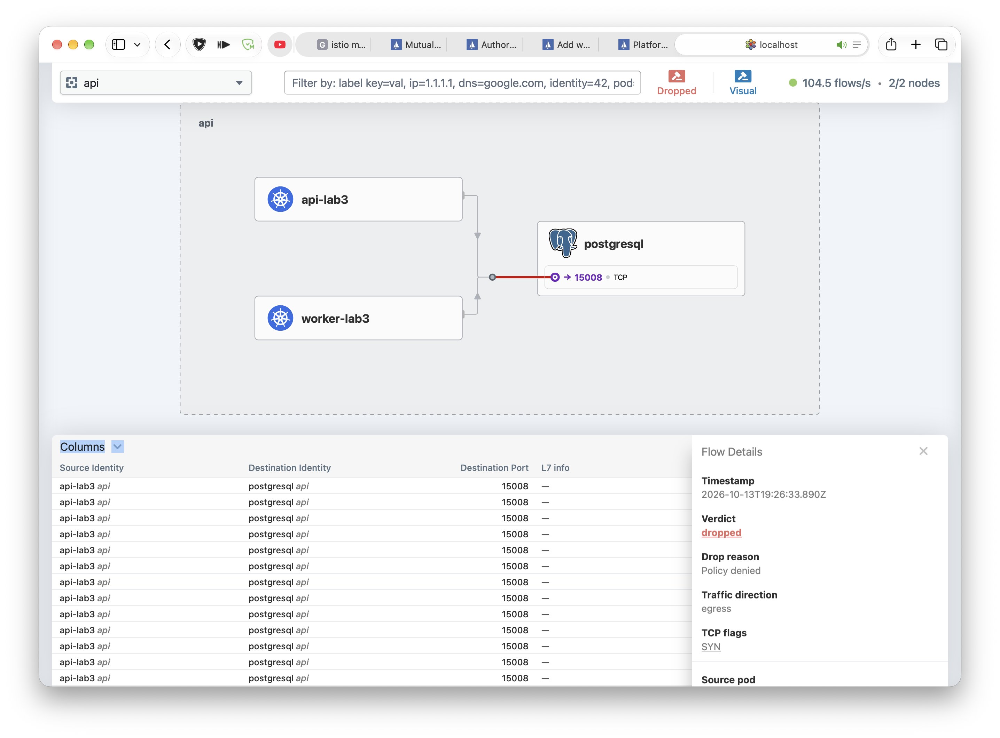

Видно, что полиси не дает egress трафик на 15008 порт.
Узнаем, что 15008 порт - порт ztunnel, который принимает соединения, и находим в [доке подобную проблему](https://istio.io/latest/docs/ambient/usage/networkpolicy/#ambient-traffic-overlay-and-kubernetes-networkpolicy).
Решение простое - добавим в полиси разрешение на трафик 15008 порта. 
После этого все заработало. 

Проверим, что трафик действительно идет через mesh. 

Первым косвенным подтверждением была проблема с полиси, доказывающая, что трафик идет через ztunnel.

Через istioctl можно посмотреть, какой тип соединения установлен между компонентами. 
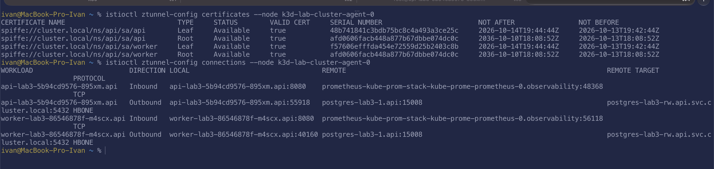
На скрине видно, что у сервисов в ns api (то есть сервисов в mesh) протокол общения HBONE.
Это внутренний протокол туннелирования в istio. 
Компоненты мониторинга (находятся вне mesh) используют TCP протокол.
С помощью полиси istio можно запретить незащищённое подключение (то есть вне mesh), 
но по умолчанию все разрешено. 
Кроме того, на скриншоте можно посмотреть информацию о сертификатах для mTLS, 
которая показывает, что сервисы внутри api имеют разный identity из-за разных SA. 

Еще можно посмотреть в логах ztunnel, что пакетики туда-сюда летают
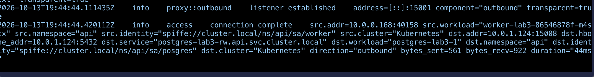

<a id="reliability"></a>
## 4. Проверка отказоустойчивости
В описанном сценарии добиться отказоустойчивости поможет механизм retry в ресурсе VirtualService. 
VirtualService по сути только описывает правила, но не создает сервиса. 
Так как коды ошибок — это L7, то нам надо L7 прокся в виде waypoint. 

Waypoint может быть общим для разных ресурсов или неймпсейсов. 
В моем случае сгенерируем waypoint для всех service в ns api командой `istioctl waypoint generate --for service -n api`
```
apiVersion: gateway.networking.k8s.io/v1
kind: Gateway
metadata:
  labels:
    istio.io/waypoint-for: service
  name: waypoint
  namespace: api
spec:
  gatewayClassName: istio-waypoint
  listeners:
  - name: mesh
    port: 15008
    protocol: HBONE
```

По сути это ресурс самого k8s Gateway, описывающий для istio конфигурацию. 
После применения этого манифеста контроллер istio в ns api создал envoy Deployment (по сути это и есть запущенная прокся)
и сервис для него.

ОЧЕВИДНО, что будут приколы с сетевой политикой. 
Waypoint не поднимается, потому что не может csr получить снова из-за default-deny policy. 
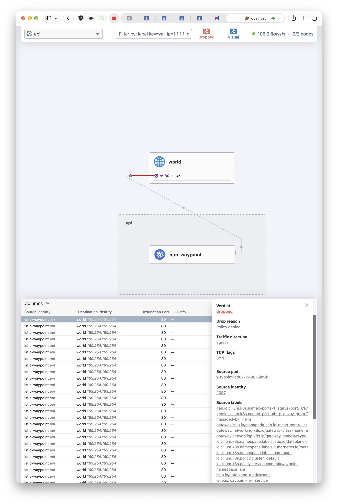
Забавно, что после деплоя я не проверил состояние waypoint и сразу пошел делать следующий этап, 
а о проблеме узнал, потому что в тг пришел алерт (правило алерта универсальное под всё в api)
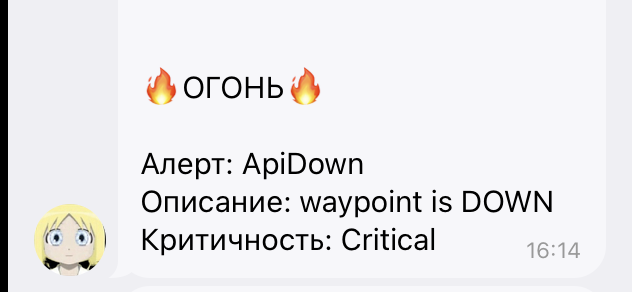

Вообще, для подобных случаев есть [официальные чарты](https://istio.io/latest/docs/setup/additional-setup/network-policy/) с сетевыми политиками, но не важно. 

Наконец-то можно перейти к отказоустойчивости. 
Создадим VirtualService, который весь трафик будет отправлять на сервис api, 
а при получении 500 будет с заданными параметрами пробовать еще раз выполнить запрос. 

```
apiVersion: networking.istio.io/v1
kind: VirtualService
metadata:
  name: api-route
spec:
  hosts:
  - api-lab3.api.svc.cluster.local
  http:
  - route:
    - destination:
        host: api-lab3.api.svc.cluster.local
    retries:
      attempts: 2
      perTryTimeout: 1s
      retryOn: 5xx
```
Также навесим на сервис лейбл `istio.io/use-waypoint: waypoint`

Перед проверкой надо настроить получение метрик waypoint, 
чтобы можно было получить реальную статистику по запросам со стороны istio, 
а не то, что видит клиент/api.
Аналогично [доке](https://istio.io/latest/docs/ops/integrations/prometheus/#option-2-customized-scraping-configurations) создадим [PodMonitor](../helmfile/charts/istio-templates/templates/waypointPodMonitor.yaml).
Важно прописать ендпоинт для скрейпа метрик, потому что wayPoint отдает на нестандартном `/stats/metrics`. 
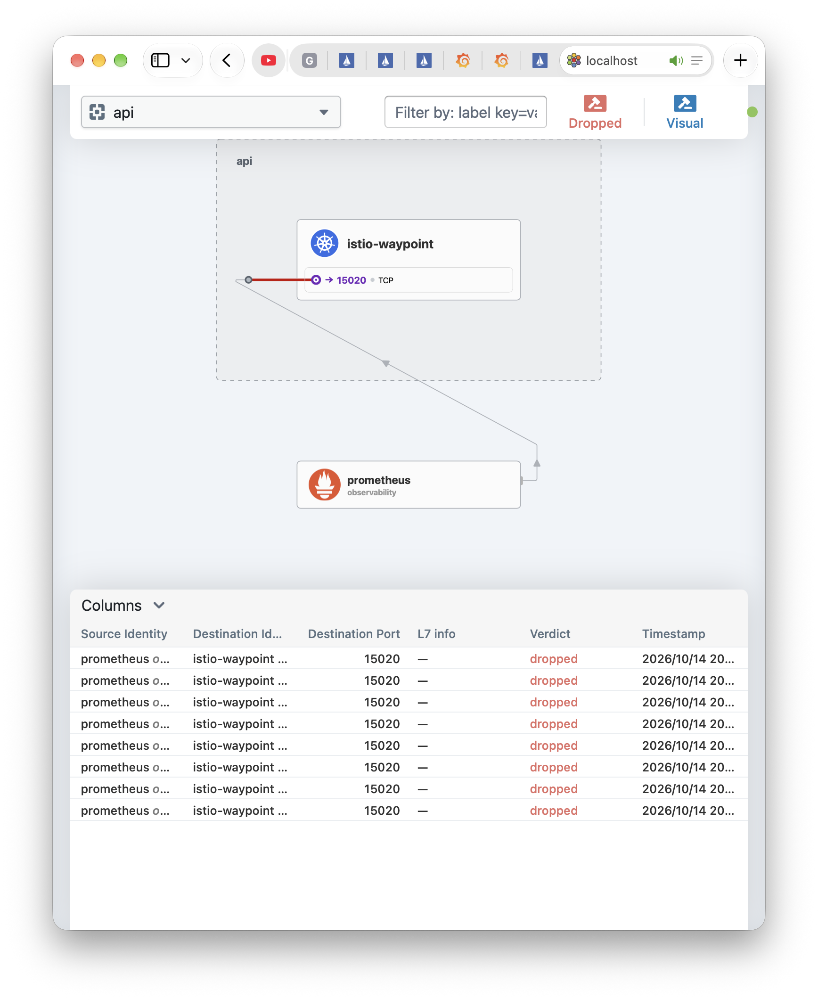
А, снова меняем NetworkPolicy дабы прометей мог ходить в waypoint за метриками.

На этом моменте я бы хотел перейти к проверке работы retry,
НО меня ждет приключение с traefik.
Трафик я пускаю через ингрес, а его поды находятся вне mesh.
То есть итоговый трафик будет идти в обход istio. 

Простым (но костыльным) решением было бы накинуть на весь ns kube-system (там развернут traefik) лейбл для вхождения в mesh.
Однако, в istio настроено исключение `EXCLUDE_NAMESPACES: kube-system`, которое не даст сделать это (видимо, слишком костыльный костыль).

Поэтому навесим только на сами поды traefik лейбл `istio.io/dataplane-mode: ambient`.
Т.к. траефик встроенный компонент k3d, то эту манипуляцию просто так не сделать. 
Благо разработчики предусмотрели такой юзкейс и через кастомный ресурс [HelmChartConfig](https://docs.k3s.io/add-ons/helm#customizing-packaged-components-with-helmchartconfig) можно поменять значения встроенных компонентов.

```
apiVersion: helm.cattle.io/v1
kind: HelmChartConfig
metadata:
  name: traefik
  namespace: kube-system
spec:
  valuesContent: |-
    podLabels:
      istio.io/dataplane-mode: ambient
```

По классике опять пришлось [сетевые политики](../helmfile/charts/istio-templates/templates/waypointPolicy.yaml) тыкать, 
потому что теперь надо дать разрешение для traefik ходить в waypoint.
А еще навесить `service.nativelb: "true"` на сервис, 
дабы traefik не ломал ничего своей балансировкой. 

Наконец-то всё работает. Пустим трафик на api и с помощью следующих метрик убедимся в работе retry
- http_requests_total: метрика api, показывает реальное кол-во ошибок
- istio_requests_total: метрика waypoint, покажет, что видит клиент

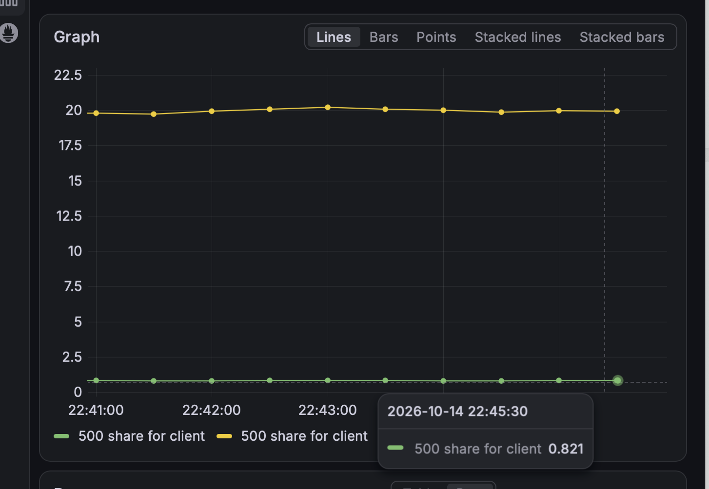
На графике видно, что где-то 20% всех запросов отдали 500,
 но на стороне клиента 500 составили менее 1% от всех запросов.

<a id="traffic-split"></a>
## 5. Развёртывание v1/v2 и разделение трафика
Для этого теста убрал Retry из прошлого задания

На стороне деплоя api добавим второй релиз с api-v2, 
чуть-чуть изменим шаблон service для возможности создания общего сервиса на v1 и v2 (вообще во время написания отчета понял, что это хрень какая-то и можно было на уровне VirtualService направить в разные сервисы).

Чтобы дать istio понять, какие версии вообще существуют, [создадим ресурс](../helmfile/charts/istio-templates/templates/destinationPolicy.yaml) `DestinationRule`
и укажем в нем два subset под v1 и v2.
DestinationRule имеет куда больше возможностей, но для разделения трафика хватит и этого.

Теперь укажем в [виртуальном сервисе ](../helmfile/charts/istio-templates/templates/visrtualService.yaml) куда направлять сабсет и с какими весами. 

Проверим работу, развернув обе версии и запустив трафик. 
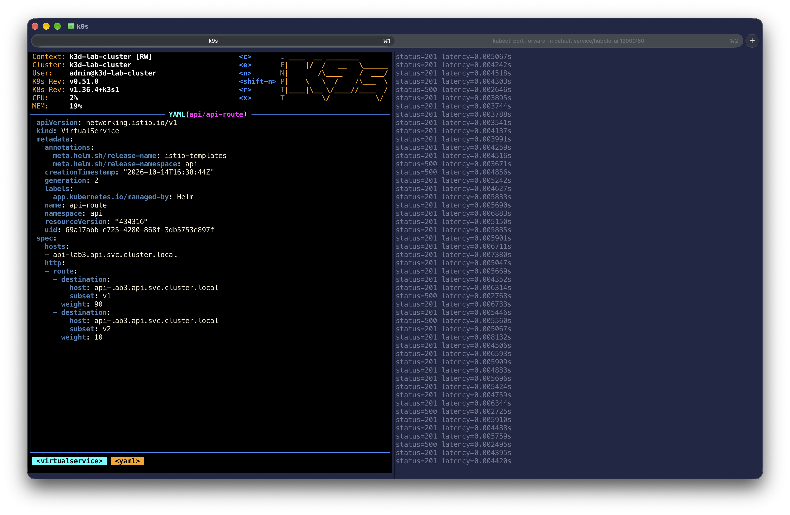

Для наглядности построил график RPS для обеих версий.
На нем видно, что соотношение действительно примерно 90/10
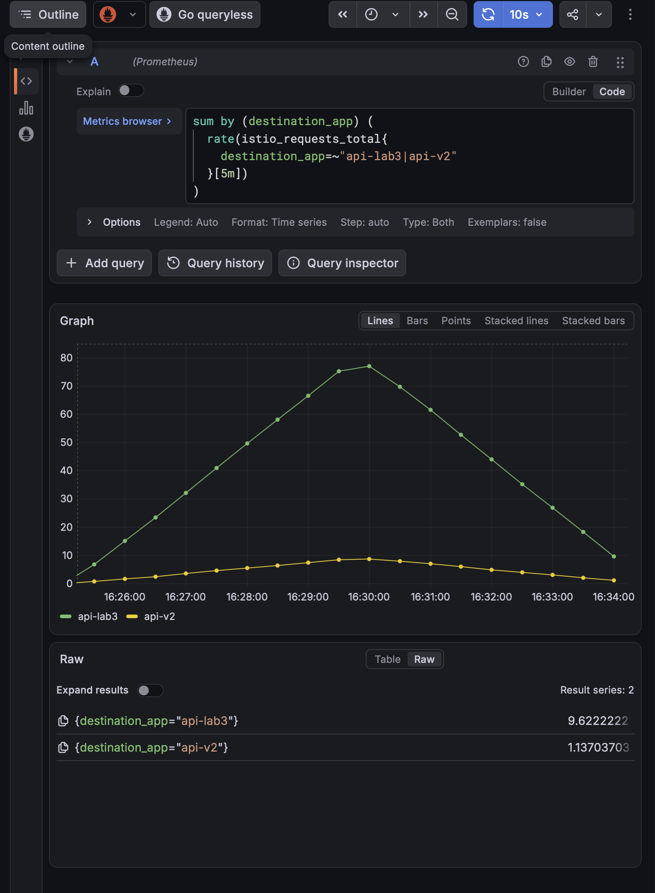


<a id="autopilot"></a>
## 6. Логика автоматического управления релизом

Самое время наИИслопить [гейт-скрипт](./gate/gate.sh). Это будет баш-скрипт, который берет из прома
метрики и на их основе вычисляет новые веса. 
Применять новые значения будет простым kubectl apply на шаблон VirtualService, 
куда значения передаются через envsubst.

<a id="release-scenarios"></a>
## 7. Проверка плохого и хорошего релиза
**Bad release**

Ожидаемое поведение: откат трафика на V1.

Начальное состояние:
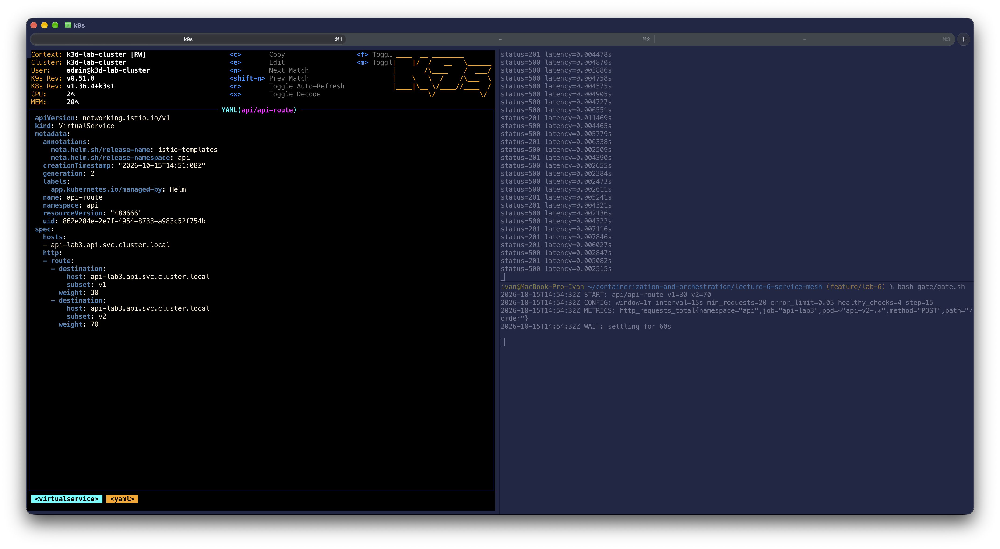

Конечное состояние:
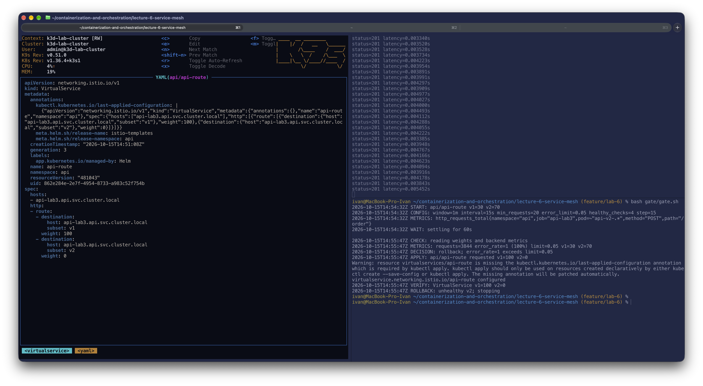

Скрипт действительно откатил весь трафик на V1

**Good release**

Ожидаемое поведение: плавное переключение трафика на новую версию

Начальное состояние:
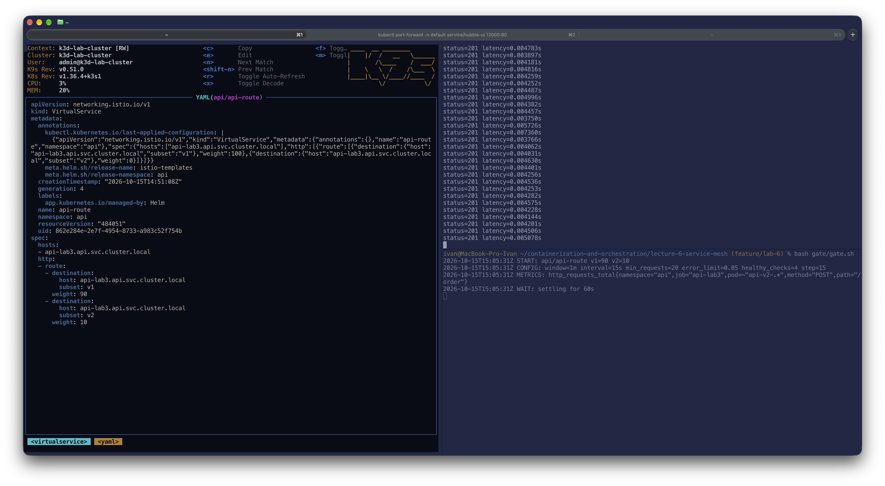

Один шаг проверки:
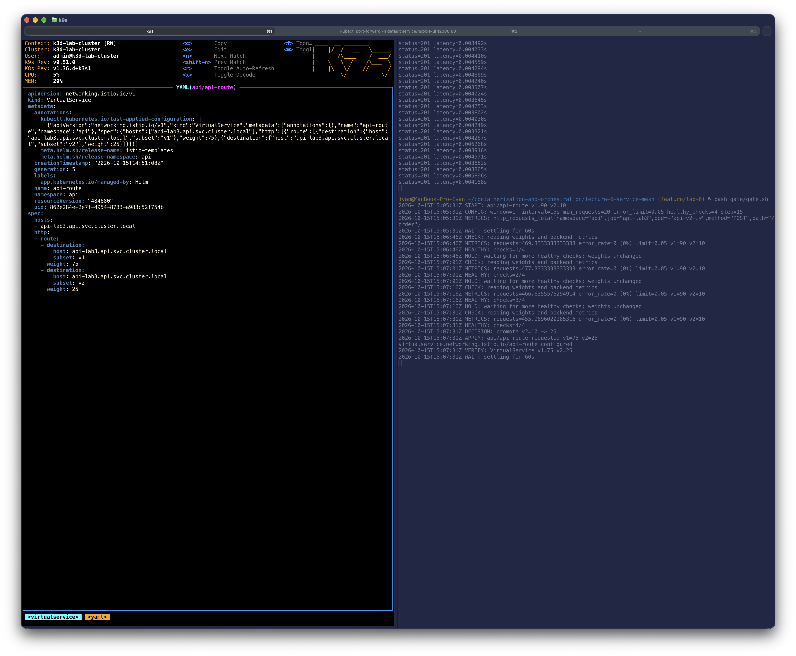

Конечное состояние:
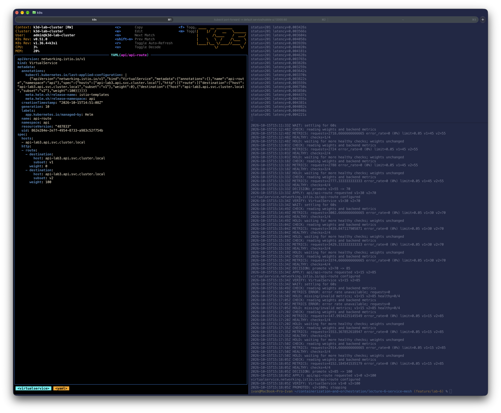

График доли V2 запросов:
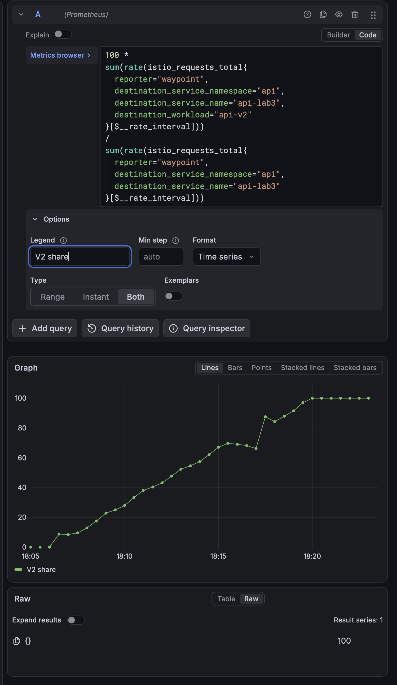

Трафик действительно полностью был переведен на новую версию.

<a id="mesh-cost"></a>
## 8. Оценка задержки и расхода ресурсов mesh

Как говорилось где-то выше, изначальные baseline замеры были некорректными, 
потому что считали только latency внутри самого мс, а не полного пути. 
Поэтому после взятия замеров с mesh traefik и api были выведены временно из мэша для проведения замеров. 

Ниже приведены результаты замеров

 | Задержка | Без mesh | С mesh | Прибавка |
|---|---:|---:|---:|
| Средняя | 3,393 мс | 4,110 мс | +0,718 мс / **21,1%** |
| p50 | 3,265 мс | 3,962 мс | +0,697 мс / **21,3%** |
| p95 | 4,623 мс | 5,418 мс | +0,795 мс / **17,2%** |
| p99 | 6,727 мс | 7,604 мс | +0,877 мс / **13,0%** |

Можно увидеть, что задержка увеличилась примерно на 0.7 мс,
что выражается примерно в 20%-ной прибавке к общей задержке. 

В документации istio есть примерные [цифры увеличения задержки](https://istio.io/latest/docs/ops/deployment/performance-and-scalability/#latency).
Там цифры поменьше, но не радикально. 

Реальное потребление считалось через `kubectl top pods --containers`.

| Компонент | Pod | CPU | RAM |
|---|---|---:|---:|
| Istiod | `istiod-574cc458f-47lrp` | 1m | 67 MiB |
| Istio CNI | `istio-cni-node-fgk7c` | 1m | 28 MiB |
| Istio CNI | `istio-cni-node-wdvl7` | 1m | 22 MiB |
| Ztunnel | `ztunnel-lcg6b` | 32m | 8 MiB |
| Ztunnel | `ztunnel-w4jvt` | 23m | 12 MiB |
| Waypoint | `waypoint-cd8779496-h5kvv` | 37m | 45 MiB |
| **Всего Istio** | **6 Pod** | **95m** | **182 MiB** |

При этом стоит учитывать, что часть компонентов (например, ztunnel) должны находиться на каждом узле,
поэтому просто для работы istio в кластере с бОльшим кол-вом нод потребуется больше доп. ресурсов.
Полученные данные +- соответствуют таковым из [документации](https://istio.io/latest/docs/ops/deployment/performance-and-scalability/#sidecar-and-ztunnel-resource-usage)

**Выводы по ресурсам**

По потреблению RAM и CPU цифры очень небольшие, 
как будто даже в небольшом кластере можно спокойно использовать, не волнуясь о потреблении.

Прибавка к общей задержке получилась солидной (в районе 20%). 
Однако стоит учитывать, что запросы были тестовыми с минимальным количеством интеграций. 
В реальном проекте, где сервис может выполнять большие запросы в базу данных и ждать ответа от других интеграций, 
прибавка в 0.8 мс будет куда менее заметной. 
<a id="monitoring"></a>
## 9. Мониторинг

Для мониторинга добавил следующие графики
- p95 времени ответа с разбивкой по версиям api
- доля 500 с разбивкой по версии
- RPS с разбивкой по версии

Использовались метрики istio. 
Информация о версиях берется из [лейблов](https://istio.io/latest/docs/ops/deployment/application-requirements/#pod-requirements), 
правда с моими лейблами это работает всрато, поэтому все приложения с лейблом 1.0.0

<a id="conclusions"></a>
## 10. Выводы
В этот раз в выводах есть что сказать, а точнее о чем поныть.

Какая-то проклятая работа, на каждом шагу что-то обязательно не работало как надо. 
Больше всего геморроя доставила default-deny сетевая политика. 
Но и другие рандомные приколы (типа введения traefik в меш или донастройки силиума) тоже приятными не были. 

Уверен, большинство проблем были вызваны отсутствием какого-либо проектирования и продумывания системы заранее. 
Но в случае учебы никто не знает, что ждет в следующей лабе... 

Честно говоря, от возни с сетевыми проблемами под конец устал,
потому процесс деплоя istio ресурсов сделан всрато 
(по сути хельм-чарт — обёртка над k8s манифестами без шаблонизации).

Просто картинка на подумать:


