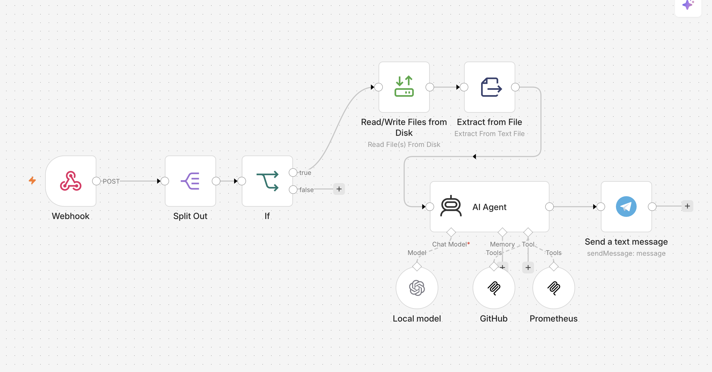
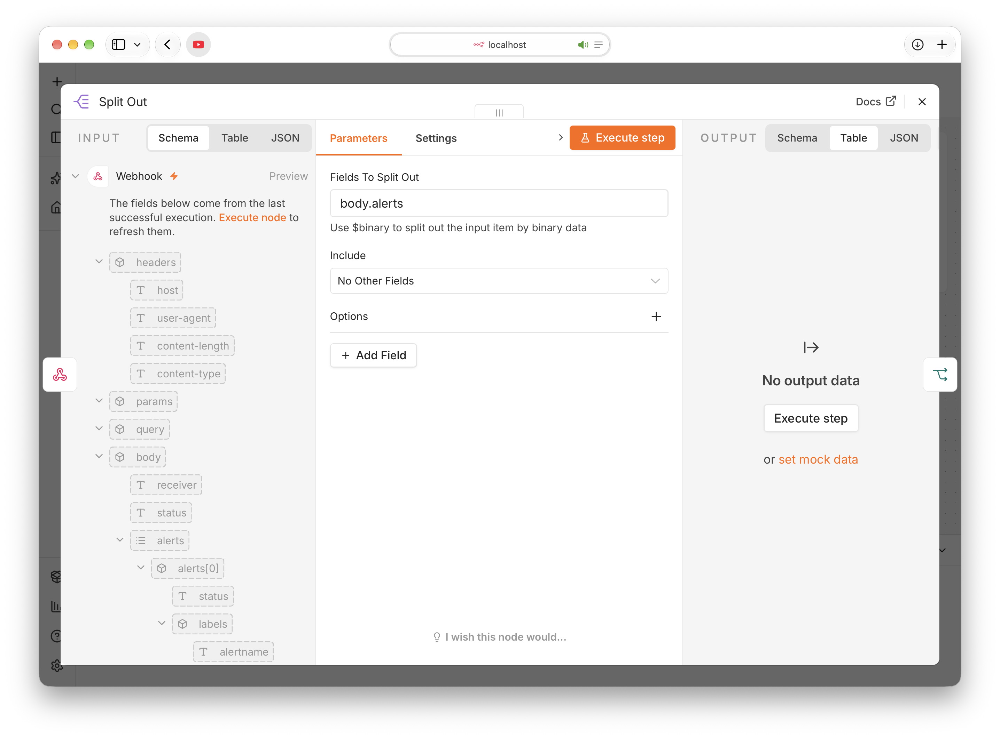
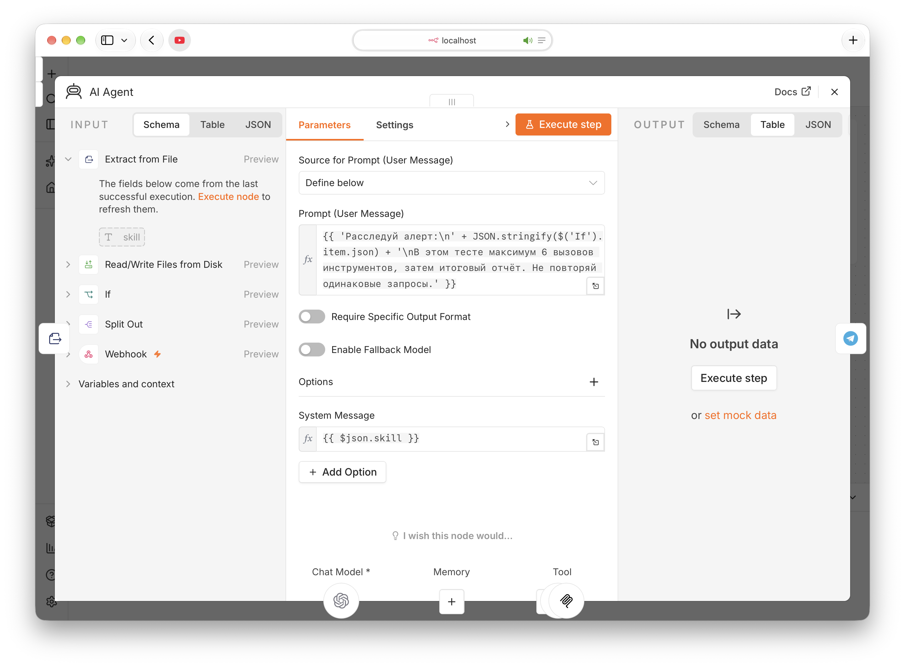
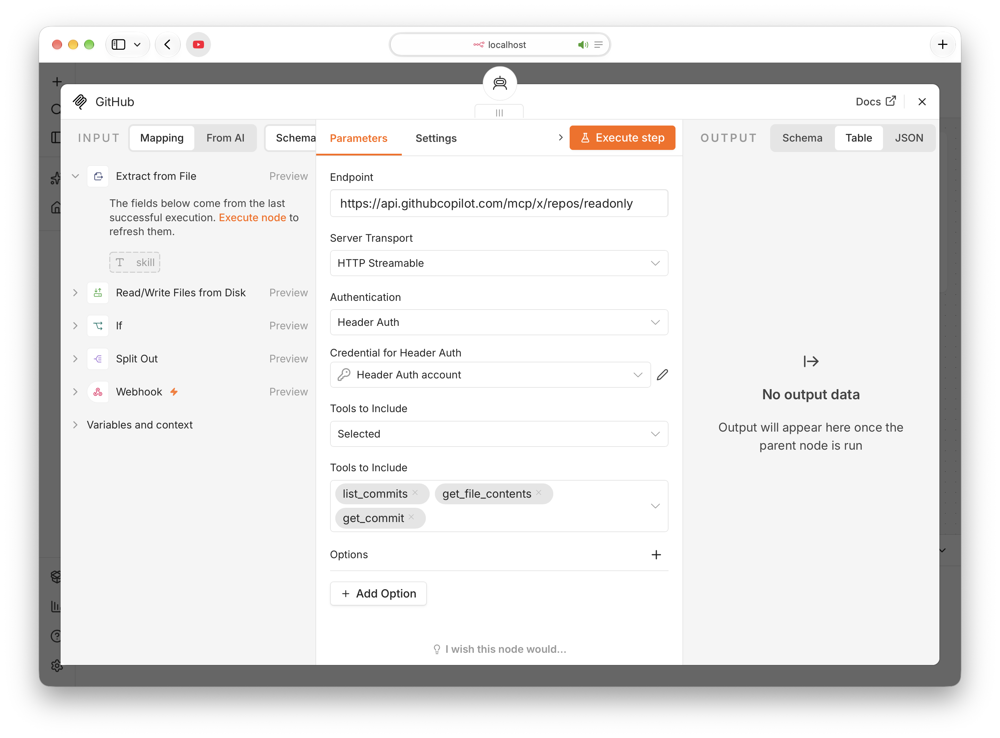
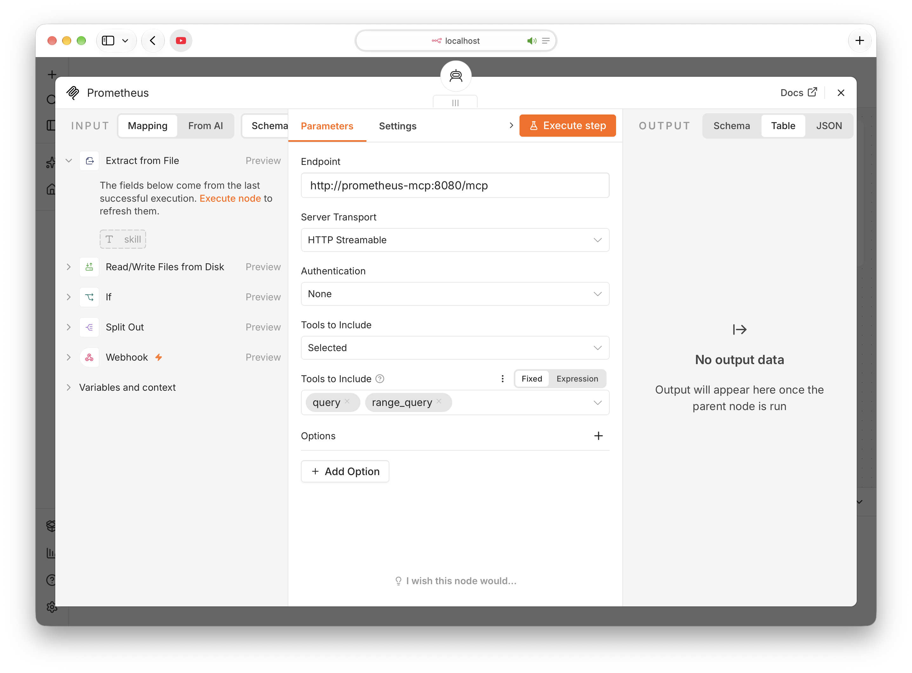
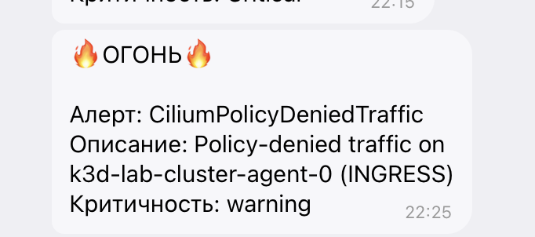
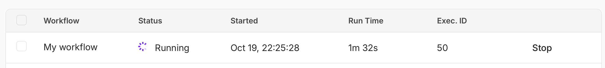
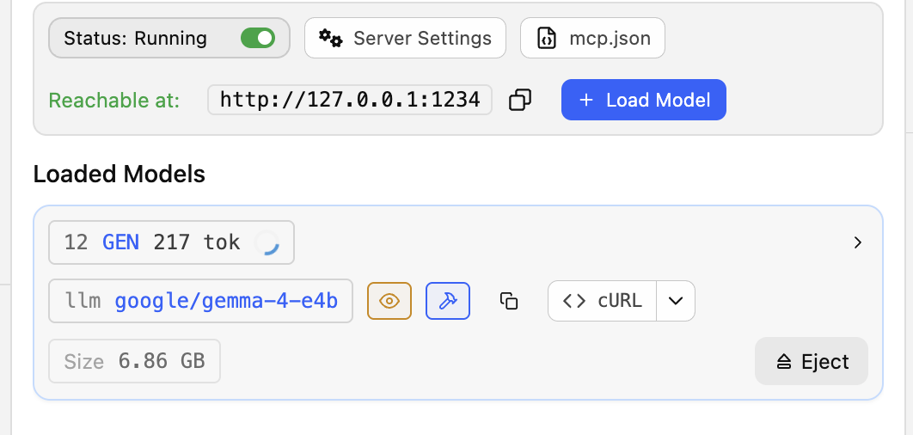
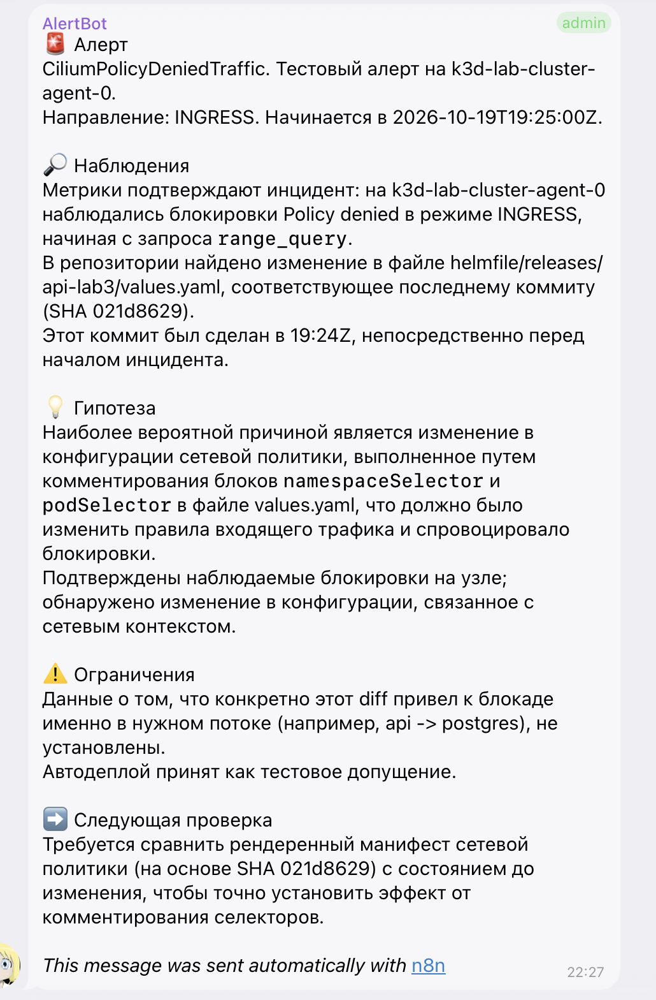
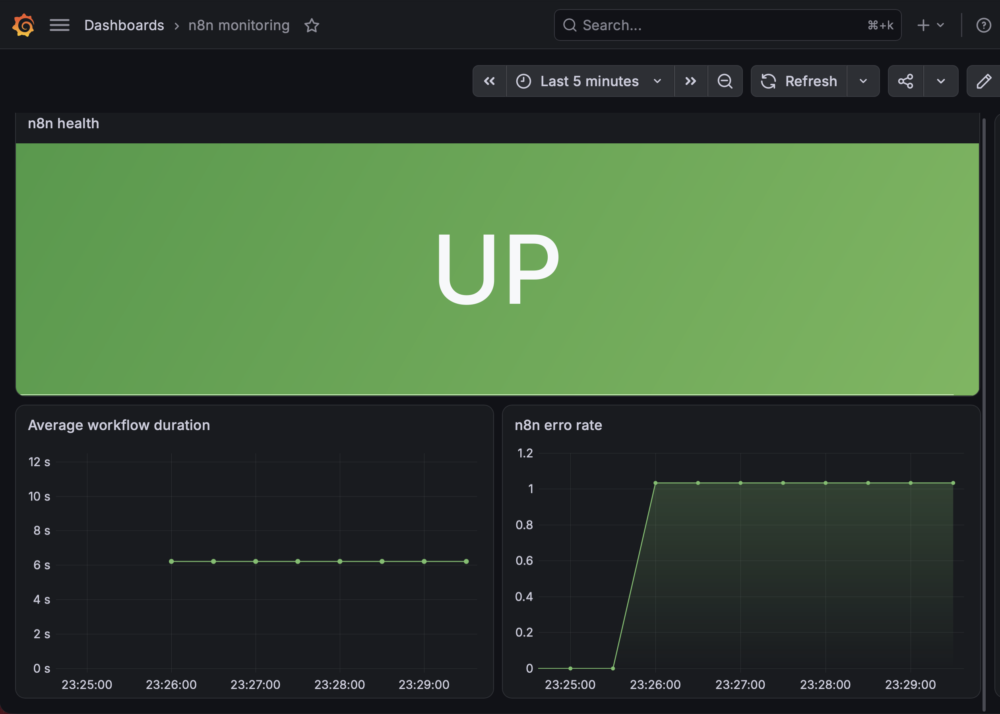

# Отчёт по лабораторной работе № 8

## Оглавление

1. [Проектирование сценария автоматизации](#use-case)
2. [Требования к реализации](#implementation)
3. [Локальный запуск](#local-run)
4. [Мониторинг](#monitoring)

## 1. Проектирование сценария автоматизации

Для автоматизации я взял процесс поиска проблем с сетевой недоступностью, 
связанных с сетевыми политиками. 

Процесс как будто довольно универсальный, 
потому пусть будет дефолтная компания средних размеров, 
в которой свыше пришел приказ внедрять AI в процессы. 
Команда DevOps подумала и придумала запрячь AI смотреть, что там с сетевыми политиками не так. 

**Кому помогает**: 
помогает DevOps-инженерам/релиз-инженерам при релизах диагностировать сетевые проблемы, связанные с сетевыми политиками

**Что решает**: 
решает проблему поиска того, какое изменение привело к сетевой недоступности. 

**Что автоматизирует**: 
локализация проблемы -> разбор метрик -> поиск изменений, создавших проблему

## 2. Требования к реализации

**Триггер**. 
Для запуска автоматизации используется AlertManager,
который отслеживает динамику policy-denied ошибок. 
При достижении критического значения алерт срабатывает и дергает вебхук в n8n, 
который и запускает воркфлоу

**Шаги без AI**. 
В самом workflow чистой логикой выполнены проверка статуса алерта (запуск только на firing), 
считывание скиллов из файла и отправка результата в telegram.
Также список алертов разделяется отдельным шагом (split out)

**AI-шаги**.
Агент анализирует метрики и коммиты в репозитории в данном временном промежутке. 

**MCP-серверы**.
Prometheus mcp для чтения метрик и GitHub mcp, чтобы смотреть изменения в репозитории. 
Оба официальные взяты, сам не писал. 

**Skill**.
Описывает порядок расследования,
правила для проверки гипотез и сам формат отчета. 

**Результат**.
Сообщение в телеграм-чат с алертами, 
которое содержит результаты расследования проблемы.

## 3. Локальный запуск

По сути кластер с сетевыми политиками и метриками уже готов из прошлых лабораторных работ, 
поэтому он будет взят для экспериментов. 

n8n развернул в [docker-compose](./deploy/docker-compose.yaml).
В том же compose описал развертывание prometheus mcp сервера. 
Засунул это всё в k3d сеть, чтобы сильно не возиться с сетью и закостылил адреса. 
Скиллы маунтятся в виде volume, дабы читать их в воркфлоу.

Чтобы это как-то работало в нынешней инфре, был написан [костыльный сервис](./deploy/n8n-monitoring.yaml) без селекторов, 
только с заданным EndpointSlice, 
в котором задан адрес контейнера n8n.
На этот сервис навешан ServiceMonitor. 
Для существующего AM добавил в качестве ресивера вебхук n8n и добавил алерт. 

Модель развернул локально через LM Studio.
Для начала использовал какой-то совсем нищий 3.5 4b, 
но он прям тупым оказался. 
В конечном варианте использовал Gemma-4 e4b MLX. 
LM Studio предоставляет встроенный сервер, чтобы слать запросы в модель. 
Апишка там наподобие OpenAI.

Ниже на рисунке представлен сам конечный workflow

Триггером для его запуска является вебхук. 
Далее в split-out компоненте из тела запроса (`body.alerts`)
берутся алерты и для каждого запускается обработка. 

В if происходит проверка `{{ $json.status }} == firing`.
В случае успешности проверки алерт отправляется на дальнейший анализ.

Шаги Read/Write files и extract from file нужны, чтобы из вольюма считать скилл и передать его агенту. 

В агенте прописаны user message и скилл как системный промпт. 

Локальная модель подключена как OpenAI-модель, 
чтобы использовать их схему API. 
Prometheus MCP развернут локально, 
GitHub mcp предоставлен самим гитхабом, 
для доступа используется сгенерированный токен для доступа только к этому репозиторию. 
Ниже будет конфигурация этих mcp серверов

Рассмотрим, какие тулзы этих MCP-серверов используются.

**GitHub**
- `list_commits`: находит коммиты выбранной ветки
- `get_commit`: получить коммит с изменениями
- `get_file_contents`: читает содержимое файла

**Prometheus**
- `query`: выполнить PromQL-запрос для конкретного момента времени
- `range_query`: получить динамику метрики за период

**Проверка работы**

Так как по сути процесса деплоя нету, 
то примем следующую условность: 
если коммит есть в репозитории, то деплой с этим коммитом уже в кластере. 

Применим все манифесты, необходимые для работы, и закомментируем какое-нибудь правило в полиси. 
Для теста уберем сетевой доступ прометеуса к чтению политик. 

Первым делом пришел сам алерт.

После этого запустился сам workflow.

Можно еще посмотреть, как пыхтит моделька.

Как итог был получен результат расследования агента в чате с алертами. 

Ресерч, конечно, довольно всратенький,
но довольно неплохо показывает, куда смотреть для диагностики. 
Этот результат был получен спустя несколько итераций правки скилла...
Возможно, модель поумнее выдала бы что-то более интересное,
потому что с еще более нищим qwen совсем всё грустно было. 

## 4. Мониторинг

Вначале уже было описано, как реализован мониторинг (через костыли).

Были добавлены графики
- статус n8n
- средняя продолжительность workflow
- error rate для workflow

